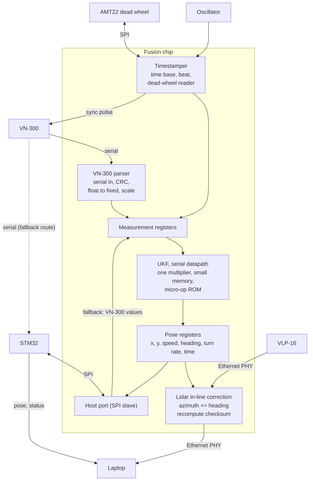

# Sensor-fusion chip: top-level architecture

Written 2026-11-21. A proposal for one Tiny Tapeout design that holds the whole
sensor-fusion function. Only the existing UKF math modules have been
synthesized; every other size here is an estimate.

Detail documents:

- [`timestamper_architecture.md`](timestamper_architecture.md)
- [`ukf_architecture.md`](ukf_architecture.md)
- [`unified_board_architecture.md`](unified_board_architecture.md) for the PCB around it

## 1. What the chip does

Sensors in, pose out:

1. Samples the dead wheel and the VN-300 on a fixed beat.
2. Fuses them in a five-state UKF into position, speed, heading and turn rate.
3. Publishes that pose.
4. Optionally corrects the lidar's packets for the robot's heading as they pass
   through.

## 2. Block diagram



## 3. Blocks

### 3.1 Timestamper

Beat generator, dead-wheel reader, sync pulse. See its own document.

### 3.2 VN-300 parser

The VN-300 is configured to send one fixed binary message on each sync pulse.
The message is a sync byte (0xFA), a header naming the fields, the payload and
a 16-bit CRC.

| Step | Work |
|---|---|
| Receive | Serial receiver, byte counter, CRC check |
| Convert | Floating point to fixed point, one field at a time through a shared shifter |
| Scale | Latitude and longitude: subtract a start-point origin, multiply by metres per degree. Heading: degrees to the filter's angle unit |

Field formats from the VN-300 interface document: latitude and longitude are
64-bit floats in degrees, yaw is a 32-bit float in degrees, angular rate is a
32-bit float in rad/s.

A configuration bit selects between this parser and values written by the
STM32. The STM32 route is built first and kept as the fallback, because a
parser fault in silicon cannot be patched and a change of message format
cannot be followed.

### 3.3 UKF

Same filter as the team's design, reshaped for area. See
[`ukf_architecture.md`](ukf_architecture.md) section 10.

- Fixed-rate loop: predict by one beat period, then correct with the beat's
  combined measurement.
- One time-shared multiplier, with the divider and square root sharing its
  adder.
- State, covariance factor and scratch values in one small memory.
- A micro-op ROM driven by the existing scheduler's {state, step} index.

### 3.4 Pose registers

The filter's output with the beat time, readable over SPI and fed to the lidar
block. Between beats the heading used by the lidar block is advanced by turn
rate × elapsed time, so the correction follows the robot through a turn.

### 3.5 Lidar in-line correction (optional)

The chip sits in the Ethernet path between the lidar and the laptop.

```
bytes in ──► pass through, a few bytes delayed ──► bytes out
                 │
                 ├─ at the two azimuth bytes of each block:
                 │      azimuth = (azimuth + heading) mod 360°
                 └─ recompute the frame checksum, append it
```

- The packet length does not change, so no packet buffer is needed.
- The laptop receives ordinary Velodyne packets and uses the standard driver.
  The cloud arrives rotated to a fixed heading, corrected about every 1.3 ms.
- A frame that arrives with a bad checksum is sent on with a deliberately bad
  checksum so the laptop drops it.
- Frames that are not lidar data pass through unchanged.

Limits:

| Limit | Detail |
|---|---|
| No x, y, z on the chip | The laptop's driver converts. Doing it on-chip quadruples the data and needs a buffer of about 1,200 bytes, which costs more than the whole chip |
| No translation | The laptop adds the robot's x and y from the published pose |
| One direction | Lidar to laptop only. The lidar must broadcast its data, with configuration done beforehand |
| Level mount | Pitch and roll are ignored |

A bypass bit passes frames through untouched.

## 4. Clocks

| Domain | Source | Used by |
|---|---|---|
| System | PCB oscillator | Everything except the Ethernet receive front end |
| Ethernet receive | Recovered by the lidar-side PHY, 25 MHz | Receive nibble sampling only |

One small clock-crossing FIFO joins them. Without the lidar block the chip has
a single clock domain.

## 5. Size budget

Gate figures are NAND2 equivalents. Tiles assume 2.3 gates per cell, measured
on the existing UKF modules, and Tiny Tapeout's guide of about 1,000 cells per
Sky130 tile.

| Block | Gates | Tiles | Basis |
|---|---|---|---|
| Timestamper | 3,000–4,000 | 1.3–1.7 | flip-flop count |
| VN-300 parser and conversion | 1,500–2,500 | 0.7–1.1 | estimate |
| UKF, serial | 15,000–18,000 | 6.5–7.8 | estimate; unit sizes from synthesis |
| Lidar in-line correction | 4,000–5,000 | 1.7–2.2 | estimate |
| Pose registers and glue | about 1,000 | 0.4 | estimate |
| **Total** | **25,000–31,000** | **11–13.5** | |

| Block size | Tiles | Fill |
|---|---|---|
| 8 × 2 | 16 | 70–85 %, too tight to rely on |
| 8 × 4 | 32 | 35–42 %, comfortable |

For comparison, the UKF as currently written on the branches (11 parallel
multipliers) synthesizes to about 134,000 gates.

## 6. Pins

Tiny Tapeout provides 24 (8 in, 8 out, 8 bidirectional).

| Use | In | Out |
|---|---|---|
| Ethernet from lidar-side PHY (4 data, valid, clock) | 6 | |
| Ethernet to laptop-side PHY (4 data, enable) | | 5 |
| Dead-wheel SPI | 1 | 3 |
| STM32 SPI | 3 | 1 |
| VN-300 serial in | 1 | |
| VN-300 sync pulse | | 1 |
| Interrupt | | 1 |
| **Total: 22** | **11** | **11** |

Sky130 output pins are rated at 33 MHz and inputs at 66 MHz. That rules out
the two-bit 50 MHz Ethernet interface and is why the four-bit 25 MHz one is
used.

Without the lidar block the chip needs 11 pins.

## 7. Risks

| Risk | Mitigation |
|---|---|
| UKF area is over half the chip and unproven in serial form | Synthesize the multiplier and memory skeleton before anything else |
| 16 fractional bits may not be enough | Fixed-point C model, run on recorded data |
| VN-300 parser fault in silicon | STM32 fallback route |
| Lidar block fault in silicon | Bypass bit |
| Fused VN-300 position makes the filter overconfident | Compare raw and fused inputs on one recorded drive; use the VN-300's reported uncertainty as the noise value |
| Second clock domain | Confined to one small FIFO; absent if the lidar block is left out |

## 8. Build order

1. Fixed-point C model in hardware operation order.
2. Serial UKF skeleton (multiplier, memory, micro-op ROM); synthesize it.
3. Timestamper, with the STM32 writing VN-300 values.
4. Whole fusion path on an FPGA on the robot.
5. VN-300 parser, checked against the STM32 route on the same data.
6. Lidar block, only if the measured total leaves room.
7. Tapeout.
