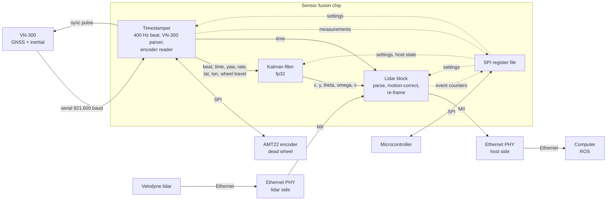
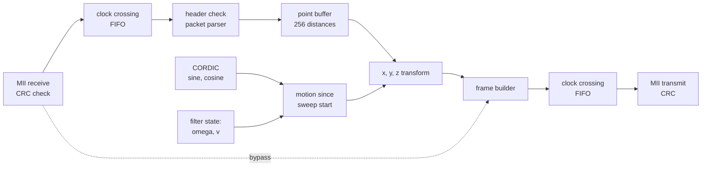

# Sensor fusion chip: system architecture

Status as of 23 November 2026. This replaces the chip-level picture in
`fusion_chip_architecture.md`, which was a proposal written before the blocks existed.

The chip is a Tiny Tapeout Sky130 project (shuttle TTSKY26d, 8×4 tiles, 24 I/O pins, 50 MHz
clock). The RTL that goes to the shuttle lives in a separate repository,
[umigv/umarv-sensorfusion-tapeout](https://github.com/umigv/umarv-sensorfusion-tapeout). This
repository holds the filter team's work and the design notes.

## What the chip does

1. Triggers the VN-300 and reads the dead-wheel encoder on a fixed 400 Hz beat, so both
   measurements belong to the same instant.
2. Runs a Kalman filter on those measurements to estimate the robot's position, heading, turn
   rate and speed.
3. Sits in line between the lidar and the computer. It converts every lidar return to x, y, z
   and removes the smear caused by the robot moving while the lidar spins.
4. Lets a microcontroller configure it and read results over SPI.

## System diagram

## Blocks

| Block | Job | State | Owner |
|---|---|---|---|
| Timestamper | beat, VN-300 sync and parser, encoder read | done; passed the full Tiny Tapeout build | cheerfulconnor |
| Lidar block | Ethernet in, corrected points out | written; passes simulation pin to pin; backend trial in progress | cheerfulconnor |
| SPI register file | settings in, status and measurements out | written; passes simulation; not yet wired into the top level | cheerfulconnor |
| Kalman filter | state estimate | fp32 multiply-accumulate, divide/square-root and a Cholesky downdate exist; no sequencer, storage or top level yet | filter team |

### Timestamper

- Counts real microseconds from the 50 MHz clock and produces a **beat** every `period_us`
  (2,500 µs, 400 Hz).
- On each beat it pulses the VN-300's SyncIn pin and reads the encoder over SPI.
- It parses the VN-300's binary message (yaw, turn rate, latitude, longitude, status), checks
  its CRC, and checks the encoder's parity bits.
- When both have answered, or at `deadline_us` (2,000 µs) if one has not, it raises one pulse
  and presents the measurements with a valid bit each.

Values are passed on **as the sensors send them**: yaw and turn rate as IEEE single precision,
latitude and longitude as double precision, wheel travel as a signed count. Conversion to the
filter's units is the filter's job.

### Kalman filter

Owned by the filter team; its internals are theirs to describe (`ukf_architecture.md` covers
the earlier fixed-point version). What the rest of the chip relies on:

- **Number format:** IEEE single precision throughout. Simulation showed 32-bit fixed point
  loses the filter's small corrections at 400 Hz, while fp32 matches double precision.
- **In:** the timestamper's pulse and measurements.
- **Out:** `x`, `y` (metres), `theta` (radians), `omega` (radians per second) and forward speed
  `v` (metres per second), each fp32, with the beat's timestamp and a one-clock valid pulse.
- **Rate:** one update per beat. The fp32 multiply-accumulate takes about 51 clocks per
  operation, so a beat has room for roughly 2,400 operations.

**Until the filter exists**, the microcontroller can write a state (or just turn rate and
speed) into the register file, and the lidar block uses that instead.

### Lidar block

- **What the correction means** (agreed with the navigation team): each sweep is put into one
  frame, the robot's own frame at the moment that sweep started. Points are turned back and
  moved back by however much the robot has turned and travelled since then. Points are **not**
  rotated into the world frame; the filter state rides along in each packet so the computer
  can place the sweep itself.
- **Arithmetic:** 16-bit fixed point for points. The fp32 unit is far too slow for 290,000
  points per second. `omega` and `v` are converted from fp32 once per filter update.
- **Lidars:** VLP-16, Puck LITE, Puck Hi-Res, VLP-32C and HDL-32E, chosen by a register. Only
  the VLP-16 has been simulated.
- **Bypass:** a register bit makes the block forward the lidar's frames unchanged.
- **Output format:** `docs/lidar_output_format.md` in the tapeout repository.

### SPI register file

The microcontroller is the SPI master (mode 0, up to 5 MHz). The first byte of a transfer is
`{write, address[6:0]}`; data bytes follow and the address counts up.

| Address | Contents |
|---|---|
| `00`–`01` | ID and version |
| `02`–`03` | control bits (block enables, bypass, correction enables) and lidar model |
| `04`–`0B` | beat period, deadline, lidar UDP port, lidar mounting angle |
| `0C`–`23` | source and destination MAC, IP and UDP port for the outgoing lidar packets |
| `24`–`3D` | host-supplied state, its strobe, and the counter clear |
| `40`–`46` | event counters |
| `48`–`6B` | last beat time, valid bits, VN-300 yaw, rate, latitude, longitude, encoder travel |

Reset values let the chip run with no host attached: the timestamper and lidar block are on,
with default addresses.

## Clocks and resets

| Clock | Source | What runs on it |
|---|---|---|
| `clk`, 50 MHz | board oscillator | everything except the two rows below |
| `mii_rx_clk`, 25 MHz | lidar-side PHY | MII receiver and the write side of its FIFO |
| `mii_tx_clk`, 25 MHz | host-side PHY | MII transmitter and the read side of its FIFO |

- The three clocks are unrelated. Data crosses only through two asynchronous FIFOs (Gray-coded
  pointers, two-flop synchronisers).
- The serial and SPI pins are sampled with `clk`, so they add no clock domains.
- Reset asserts at once and releases in step with each domain's own clock.

## Pins

| Use | Pins |
|---|---|
| Lidar-side MII receive: clock, data valid, 4 data | 6 |
| Host-side MII transmit: clock, enable, 4 data | 6 |
| VN-300: serial in, sync out | 2 |
| Encoder SPI | 4 |
| Host SPI | 4 |
| Measurements-ready pulse, one spare | 2 |
| **Total** | **24 of 24** |

Only half of each Ethernet link is connected. Nothing travels from the computer back to the
lidar through the chip.

## Area

Cell area from synthesis against the Sky130 high-density library, in Tiny Tapeout tiles
(17,955 µm² each). The 8×4 block is 32 tiles and holds about 19 tiles of cells at the default
60% density.

| Block | Tiles | Basis |
|---|---|---|
| Timestamper | 1.2 | measured |
| Lidar block | 12.4 | measured, with the point buffer in latches |
| SPI register file | about 1 | estimate |
| Kalman filter | about 9 to 10 | estimate; only the two arithmetic units (1.6) are measured |
| **Total** | **about 24 to 25** | |

That is above what fits comfortably. The first backend trial of the timestamper and lidar
block alone ran out of room while fixing hold violations; a second trial with the smaller
buffer is in progress. **Area is the main risk to the chip as drawn.**

## What is not settled

| Item | Why it matters |
|---|---|
| Whether the filter is ready by the shuttle close (30 November) | without it the chip ships with the host-supplied state path |
| The filter's exact state and interface signals | the lidar block needs `omega` and `v`; the packet header carries `x`, `y`, `theta` too |
| Whether the whole chip fits in 8×4 | see Area |
| Timing constraints for the two MII clocks | the trial builds leave them unconstrained |
| Behaviour on real sensors | the VN-300 message layout, CRC byte order and encoder parity bits are from datasheets, not hardware |
| Filter tuning registers | none are defined; addresses `6C`–`7F` are free |
