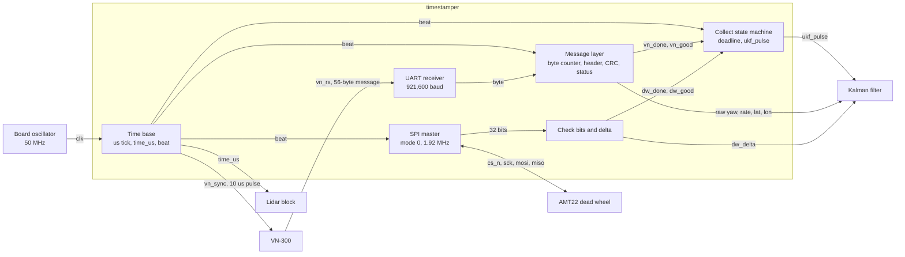

# Timestamper

Source: [`src/timestamper.sv`](../src/timestamper.sv)

The timestamper is the sensor front end of the fusion chip. On a fixed beat (400 Hz by default) it:

- keeps the chip's microsecond clock,
- pulses the VN-300's SyncIn pin and receives the binary message the VN-300 sends back,
- reads the AMT22 dead-wheel encoder over SPI,
- checks both, and hands one consistent set of measurements to the Kalman filter with a start pulse.

It does no arithmetic on the VN-300 values. They are passed on as the raw IEEE floats and doubles the
VN-300 sent, and the Kalman side converts them.

## Block diagram

## What happens in one beat

Times are for the default settings (50 MHz clock, 2,500 us period, 2,000 us deadline).

| Time after the beat | Event |
|---|---|
| 0 | `beat`. `beat_ts` is latched, `vn_sync` goes high, the SPI read starts, the valid flags and the message byte counter are cleared |
| 10 us | `vn_sync` goes low |
| 32 us | the encoder read is finished and checked |
| about 0.65 ms | the VN-300 message has arrived and been checked (0.6 ms of serial time plus the VN-300's response delay) |
| as soon as both are in | `ukf_pulse` for one clock |
| 2,001 us | if either sensor has not answered, `ukf_pulse` fires anyway with that sensor's valid flag low |
| 2,500 us | next beat |

## Ports

| Port | Dir | Width | Meaning |
|---|---|---|---|
| `clk`, `rst_n` | in | 1 | 50 MHz clock; active-low reset, asserted asynchronously |
| `enable` | in | 1 | 0 stops the beat; `time_us` keeps running |
| `period_us` | in | 16 | beat period in microseconds (2,500 for 400 Hz) |
| `deadline_us` | in | 16 | how long after the beat to wait for the sensors (for example 2,000) |
| `dw_check_turns` | in | 1 | 1: the encoder's turn-count word must pass its check bits too |
| `incr`, `spi_half_div` | in | 32, 8 | not used at present |
| `vn_sync` | out | 1 | to the VN-300 SyncIn pin |
| `vn_rx` | in | 1 | serial data from the VN-300 |
| `cs_n`, `sck`, `mosi` | out | 1 | SPI to the AMT22 |
| `miso` | in | 1 | SPI from the AMT22 |
| `ukf_pulse` | out | 1 | one clock: measurements for this beat are ready |
| `ukf_regfile` | out | struct | the measurements, see below |
| `time_us` | out | 40 | free-running microsecond clock |

### `ukf_regfile`

| Field | Width | Contents |
|---|---|---|
| `beat_ts` | 32 | low 32 bits of `time_us` at the beat |
| `vn_valid` | 1 | a message arrived this beat with the right header, a good CRC, and INS status "tracking, GNSS fix, no error" |
| `vn_yaw_f32` | 32 | IEEE float, degrees, clockwise from north |
| `vn_rate_f32` | 32 | IEEE float, rad/s, about the body Z axis (Z points down) |
| `vn_lat_f64` | 64 | IEEE double, degrees |
| `vn_lon_f64` | 64 | IEEE double, degrees |
| `dw_valid` | 1 | this beat's encoder reading passed its check bits and there was an earlier good reading |
| `dw_delta` | 28, signed | encoder counts moved since the last good reading |

## Contract for the Kalman side

1. **Start on `ukf_pulse`, not on the beat.** There is exactly one `ukf_pulse` per beat, between about 0.65 ms and `deadline_us` after it.
2. **Read inside the window.** Every field of `ukf_regfile` is steady from `ukf_pulse` until the next beat. After the next beat the VN-300 fields are overwritten as the new message arrives. Convert or copy what is needed before then.
3. **Honour the valid flags.** When `vn_valid` is 0 the four VN-300 fields may hold a corrupted or partial message and must not be used: predict only. When `dw_valid` is 0, ignore `dw_delta`.
4. **Convert the VN-300 values.** The timestamper passes raw IEEE bit patterns. The Kalman side has to turn the two floats into fixed point, and latitude and longitude into metres from an origin. Subtract the origin at full precision before rounding: one metre is about 0.000009 degrees.
5. **Fix the heading convention.** VN-300 yaw is clockwise from north and its Z axis points down. A filter using counter-clockwise angles needs the sign of yaw and of the turn rate flipped, and an offset on yaw.
6. **Treat `dw_delta` as a distance.** It is the movement since the last good reading, in counts (16,384 per wheel turn). After a rejected reading it covers more than one beat, so do not divide it by one beat period to get a speed without accounting for that.
7. **Expect no wheel data on the first beat.** After reset the first reading has nothing to subtract from, so `dw_valid` is 0 once.
8. **`beat_ts` wraps.** It is 32 bits of microseconds, about 71.6 minutes. Differences between nearby times are still correct with unsigned subtraction.

## Assumptions

These are built into the RTL. If one is wrong, the block needs changing.

**Clock and rates**

- The clock is exactly 50 MHz. The microsecond divider (50), the UART bit time (54 clocks), the SPI half period (13 clocks) and the SPI pauses (150 clocks) are hard-coded counts.
- The VN-300 serial rate is 921,600 baud.
- `deadline_us` is less than `period_us`, and both are steady while `enable` is high. If the deadline is not shorter than the period, the block still produces one pulse per beat, at the next beat.
- The beat period is longer than the VN-300's response delay plus 0.6 ms of serial time. At 400 Hz that leaves the VN-300 about 1.4 ms to respond.

**VN-300**

- SyncIn is set to trigger an output message on each pulse (SyncInMode ASYNC), on the rising edge.
- The message is binary output group 1 with field word `0x1068`: yaw/pitch/roll, angular rate, position (LLA) and INS status, 56 bytes in total starting `FA 01 68 10`.
- The CRC is CRC16-CCITT starting from zero over every byte after the `FA` sync byte, sent high byte first, so the running CRC over the whole message ends at zero.
- All multi-byte values are little-endian.
- Data is only accepted when INS status reports mode 2 (tracking), a GNSS fix, and error code 0. During alignment after power-up `vn_valid` stays 0.
- The VN-300 sends nothing between sync pulses. A message that runs past the next beat is discarded and can cost the following beat as well.

**AMT22 encoder**

- 14-bit multi-turn part (AMT222D), SPI mode 0, most significant bit first.
- One read is `00 A0 00 00`: position in the first two bytes back, turn count in the last two.
- Each returned word is two check bits then 14 data bits, with K1 = not(XOR of odd bits) and K0 = not(XOR of even bits). This is documented for the position word and assumed for the turn-count word; `dw_check_turns` = 0 switches that second check off.
- The turn count is a signed 14-bit number. The 28-bit value `{turns, position}` wraps cleanly under subtraction.
- Timing delivered: 3.0 us from `cs_n` low to the first clock edge, 3.26 us between bytes, 3.26 us from the last clock edge to `cs_n` high, 1.92 MHz clock.

**Reset and clocking**

- `rst_n` is expected to be released in step with `clk` (a reset synchroniser at the top level).
- `vn_rx` and `miso` are asynchronous inputs; each passes through two flip-flops inside the block.
- Everything runs on `clk`. `sck` is a generated output, not a clock.

## Status

- Simulated with Synopsys VCS against behavioural models of the VN-300 and the AMT22: 13 beats covering good data, a corrupted message, a silent and a late VN-300, bad encoder check bits, reverse motion across a turn boundary, and disable/enable.
- Synthesised with Design Compiler against the Sky130 high-density library: 502 flip-flops, 21,833 um2 of cells, timing met at 50 MHz.
- Not yet tested against the real VN-300 or encoder. The sensor models come from the datasheets, so they cannot catch a misreading of them.
- Not yet run through the Tiny Tapeout flow, and not yet listed in `info.yaml`. The file uses SystemVerilog (a packed struct as a port, `always_ff`, `enum`), which the flow's tools may not accept as written.
