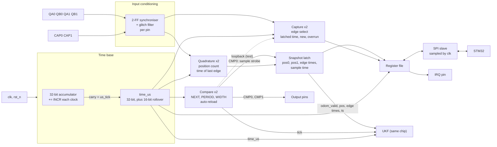
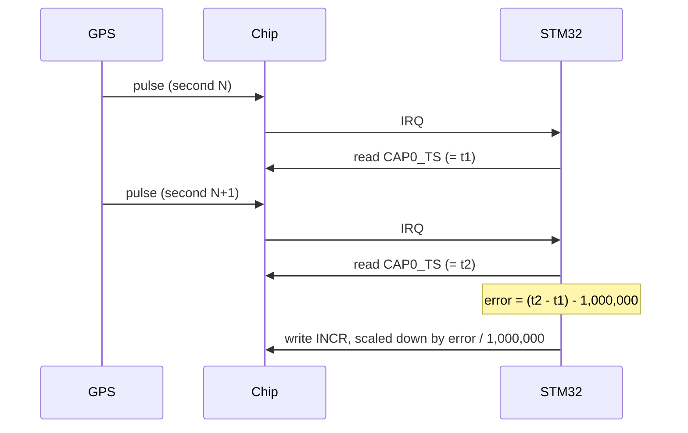

# Clock and timestamp IP: high-level architecture

A proposal for the timing block that sits beside the UKF, sized for a Tiny
Tapeout slot. Nothing here is implemented yet. Area figures are estimates from
flip-flop counts, not synthesis results.

## 1. What it does

One free-running microsecond clock, and three uses of it:

1. **Capture**: record the time at which an input changed.
2. **Compare**: change an output when the time reaches a set value.
3. **Discipline**: let the host correct the clock's rate against GPS.

Design rules chosen for tapeout:

- **One clock domain.** Every external input, including SPI, is synchronised
  and sampled by the system clock. There are no clock-domain crossings to get
  wrong in silicon.
- **No memories.** All storage is flip-flops, and events are held in
  per-channel latches, not a deep FIFO.
- **Works out of reset.** Reset values give a correct 10 MHz time base and a
  running 1 kHz tick with no configuration.
- **Policy in software.** The chip measures and generates. The STM32 runs the
  control loop that steers the clock, and formats any serial time messages.
- **Self-testable.** An internal loopback routes a compare output into a
  capture input, so a fabricated chip can check itself with no lab equipment.

## 2. Block diagram



## 3. The blocks

### 3.1 Time base

```
{us_tick, acc} <= acc + INCR        every clock
time_us        <= time_us + 1       when us_tick
```

- `INCR = 2^32 × 1,000,000 / f_clk`. Reset value 429,496,730, which is correct
  for 10 MHz. Any clock above 1 MHz works, including non-integer ratios.
- `time_us` is 32 bits and wraps after about 71.6 minutes. A 16-bit rollover
  counter extends it to about 8.9 years. Captures store the low 32 bits; the
  host reads the rollover count separately.
- `TIME_SET` loads `time_us` directly, for aligning to GPS time of day.
- Resolution is 1 µs. If finer is wanted later, the top bits of `acc` are the
  sub-microsecond fraction and can be captured alongside.

### 3.2 Input conditioning

Every input pin passes through a two-flip-flop synchroniser and then a glitch
filter that requires the new level to hold for `FILT` consecutive clocks
(0 to 15, per pin group).

This adds a fixed delay of 2 + `FILT` clocks to every timestamp. It is
constant, so it does not add jitter, and the host can subtract it.

### 3.3 Quadrature channels (2)

For drive-wheel or dead-wheel encoders. Each channel has:

- a 16-bit up/down position counter driven by the A/B transitions,
- the `time_us` of the most recent valid edge,
- an error flag for an illegal transition (both lines changing at once).

Edges are not reported individually, because an encoder can produce thousands
per second. Instead, position and last-edge time are copied into a snapshot
latch on each sample strobe (see 3.5). The host computes speed as change in
position over change in last-edge time, which stays accurate at low speed
where a fixed sample window would see only a count or two.

### 3.4 Capture channels (2)

General-purpose. Each has an edge select (rising, falling, both), a 32-bit
latched time, a `new` flag and an `overrun` flag.

| Mode | Behaviour | Use |
|---|---|---|
| Continuous | Latches every selected edge; `overrun` set if the last was unread | GPS pulse-per-second |
| One-shot | Latches the first edge, then ignores edges until the host reads it | Arrival time of a serial message (tap the UART RX line, falling edge) |

Suggested assignment: CAP0 to the GPS pulse-per-second, CAP1 to a serial RX
tap, a lidar sync output or a fault line.

### 3.5 Compare channels (2)

Each has `NEXT` (32-bit time), `PERIOD` (32-bit, 0 for one-shot), `WIDTH`
(16-bit pulse length in µs), an enable and a polarity bit.

```
when time_us == NEXT:
    fire (internal strobe, and drive the output pin for WIDTH us)
    NEXT <= NEXT + PERIOD
```

Because the next firing time is computed by adding the period to the previous
one, the output never accumulates drift relative to `time_us`.

| Channel | Reset state | Role |
|---|---|---|
| CMP0 | enabled, period 1000 µs | Sample strobe: snapshots the encoders, gives the UKF its tick, and can drive an ADC trigger pin |
| CMP1 | disabled | Pulse-per-second output for the lidar, or a camera trigger |

### 3.6 Snapshot latch

On each CMP0 strobe, these are copied together so the host and the UKF see a
consistent set:

```
SNAP_TS    time of the strobe
SNAP_POS0  SNAP_EDGE0     position and last-edge time, channel 0
SNAP_POS1  SNAP_EDGE1     position and last-edge time, channel 1
```

### 3.7 Host interface

SPI slave, mode 0, with the SPI clock sampled by the system clock (SPI clock
at most one eighth of the system clock). One transaction is an 8-bit command
(read/write bit plus 7-bit address) followed by 32 bits of data.

- The addressed register is copied into a shadow register at the end of the
  command byte, so a value cannot change while it is being shifted out.
- Reading a capture register clears its `new` and `overrun` flags.
- The IRQ pin is the OR of enabled status flags.

### 3.8 Interface to the UKF

Internal to the chip, no pins:

| Signal | Meaning |
|---|---|
| `time_us[31:0]` | current time |
| `tick` | CMP0 strobe |
| `odom_valid`, `SNAP_*` | a fresh encoder snapshot |
| `cap_valid[1:0]`, `cap_ts` | a capture event, for stamping a GPS fix |

These map onto the scheduler's existing `tick_1khz` and `fifo_ts` inputs.

## 4. Register map

All registers are 32 bits. Addresses are provisional.

| Addr | Name | Access | Reset | Contents |
|---|---|---|---|---|
| 0x00 | ID | R | fixed | identifier and version |
| 0x01 | CTRL | RW | 0x1 | bit 0 time base enable, bit 1 loopback, filter lengths |
| 0x02 | STATUS | R | 0 | new, overrun and quadrature error flags |
| 0x03 | IRQ_EN | RW | 0 | which STATUS bits drive the IRQ pin |
| 0x04 | INCR | RW | 429,496,730 | time base increment |
| 0x05 | TIME | R | 0 | `time_us` |
| 0x06 | TIME_HI | R | 0 | rollover count |
| 0x07 | TIME_SET | W | – | load `time_us` |
| 0x08 | CAP0_CFG | RW | 0 | enable, edge select, mode |
| 0x09 | CAP0_TS | R | 0 | captured time |
| 0x0A | CAP1_CFG | RW | 0 | |
| 0x0B | CAP1_TS | R | 0 | |
| 0x10 | CMP0_CFG | RW | enabled | enable, polarity, pin enable |
| 0x11 | CMP0_NEXT | RW | 1000 | |
| 0x12 | CMP0_PERIOD | RW | 1000 | |
| 0x13 | CMP0_WIDTH | RW | 10 | |
| 0x14–0x17 | CMP1_* | RW | disabled | as CMP0 |
| 0x20 | SNAP_TS | R | 0 | |
| 0x21 | SNAP_POS0 | R | 0 | |
| 0x22 | SNAP_EDGE0 | R | 0 | |
| 0x23 | SNAP_POS1 | R | 0 | |
| 0x24 | SNAP_EDGE1 | R | 0 | |

## 5. Pins

Tiny Tapeout provides 8 inputs, 8 outputs and 8 bidirectional pins.

| Pins | Count | Use |
|---|---|---|
| Inputs | 4 | QA0, QB0, QA1, QB1 |
| Inputs | 2 | CAP0, CAP1 |
| Outputs | 2 | CMP0, CMP1 |
| Output | 1 | IRQ |
| Output | 1 | `us_tick` (debug; lets a scope or counter verify the time base) |
| Bidirectional | 4 | SPI chip select, clock, data in, data out |
| **Total** | **14** | leaves about 10 for the UKF and protection logic |

## 6. Example traces

### 6.1 A GPS fix stamped at its true time

```
time_us     event
5,000,000   GPS pulse rises            -> CAP0_TS = 5,000,000, new = 1, IRQ
5,000,400   left encoder edge          -> channel 0 position +1, edge time = 5,000,400
5,001,000   CMP0 fires                 -> snapshot: SNAP_TS = 5,001,000,
                                          SNAP_POS0, SNAP_EDGE0 = 5,000,400
5,042,000   GPS serial message ends    -> STM32 reads CAP0_TS and tags the fix
                                          with 5,000,000, not 5,042,000
```

### 6.2 Steering the clock to GPS



If the crystal runs 30 parts per million fast, `t2 − t1` reads 1,000,030 and
the host reduces `INCR` by 30 parts per million. The loop lives in firmware,
where its gain can be tuned without a new chip.

### 6.3 Self-test with loopback

```
1. Set CTRL.loopback: CMP1 output is routed internally to CAP0.
2. Program CMP1 with PERIOD = 1,000,000.
3. Read CAP0_TS twice. The difference must be exactly 1,000,000.
```

This exercises the time base, a compare channel, a capture channel and the SPI
path with nothing connected to the chip.

## 7. Estimated size

| Block | Flip-flops |
|---|---|
| Time base (accumulator, increment, time, rollover) | 112 |
| Quadrature channels ×2, with snapshot | 216 |
| Capture channels ×2 | 80 |
| Compare channels ×2 | 192 |
| SPI and shadow register | 92 |
| Control and status | 40 |
| **Total** | **about 730** |

With the adders, comparators and the register read multiplexer, that comes to
roughly 5,000 to 7,000 NAND2 equivalents, or about three Sky130 tiles. This is
an estimate; it should be confirmed by synthesis once the RTL exists.

The cheapest reductions, if needed: store last-edge times as 24 bits, drop to
one capture channel, or share one adder between the two compare channels.

## 8. Left out on purpose

| Not included | Why |
|---|---|
| Serial time-message (NMEA) generator | The STM32 can send it after the pulse; saves about 1,500 gates |
| Deep event FIFO | Costly in flip-flops; per-channel latches with overrun flags are enough at these rates |
| On-chip clock steering loop | Firmware can tune it; a wrong loop in silicon cannot be fixed |
| Protection latch, watchdog, e-stop | Belongs in a separate block that cannot be disabled through this register map |
| PWM generation | Only needed if motor control moves onto the chip; a compare channel can be extended later |

## 9. Open questions

1. Does the robot's GPS receiver expose a pulse-per-second pin? If so, wire it
   to both the lidar and CAP0, and CMP1 is free for something else.
2. What encoder resolution and top speed set the maximum edge rate? That
   decides the glitch filter length and whether 16-bit position is enough
   between snapshots.
3. Which clock frequency will the final board use? It sets the `INCR` reset
   value and the timestamp granularity.
4. Does the UKF take encoder snapshots directly on-chip, or does the STM32
   convert them to speed and turn rate first?
