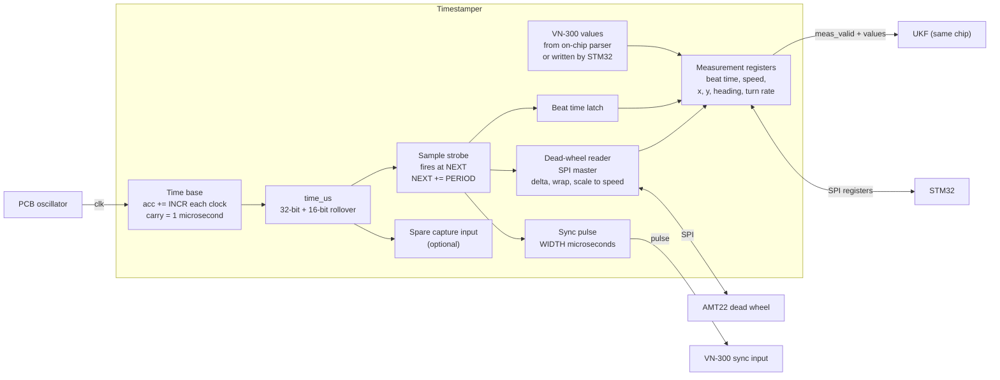

# Timestamper IP: architecture

Revised 2026-11-21. This replaces the earlier version, which assumed two
quadrature encoders and a GPS pulse-per-second capture. Nothing here is
implemented yet. Sizes are estimates, not synthesis results.

See also: [`fusion_chip_architecture.md`](fusion_chip_architecture.md) for the
whole chip, [`ukf_architecture.md`](ukf_architecture.md) for the filter.

## 1. What it does

It is a metronome. A counter fires at a fixed rate (default every 10 ms). On
each beat the block:

1. records the time,
2. reads the dead-wheel encoder,
3. pulses the VN-300 so it reports at that same moment,
4. hands the filter one set of readings that all describe that instant.

Because every input is sampled on the same beat, the filter needs no queue,
no reordering and no per-sensor timestamps.

## 2. Decisions this version is built on

| Decision | Consequence |
|---|---|
| One dead wheel, AMT22, SPI absolute encoder | An SPI master replaces the quadrature decoders. It gives forward speed only |
| VN-300 supplies position, heading and turn rate, using its fused output | No GPS pulse capture. The VN-300 is triggered through its sync input |
| Fixed-rate sampling | The time of a reading is the beat time. Nothing is captured edge by edge |
| Clock from an oscillator on the PCB, frequency set after fabrication | The clock-to-microsecond ratio is a register, with a reset value correct for 10 MHz |

## 3. Block diagram



## 4. The parts

### 4.1 Time base

```
{us_tick, acc} <= acc + INCR        every clock
time_us        <= time_us + 1       when us_tick
```

- `INCR = 2^32 × 1,000,000 / f_clk`. Reset value 429,496,730 (10 MHz).
- `time_us` is 32 bits and wraps after about 71.6 minutes. A 16-bit rollover
  counter extends it to about 8.9 years.
- The STM32 can trim `INCR` to correct crystal error if it has a reference to
  compare against. This is optional; the filter only needs the beat period to
  be consistent.

### 4.2 Sample strobe

```
when time_us == NEXT:
    fire
    NEXT <= NEXT + PERIOD
```

`PERIOD` resets to 10,000 µs. Adding the period to the previous firing time
means the beat never drifts against `time_us`.

Choosing the rate: speed resolution is one encoder count per period, so a
slower beat resolves speed more finely. As an illustration, a 14-bit encoder
on a 60 mm wheel gives about 1 mm/s at 100 Hz and about 12 mm/s at 1 kHz. The
wheel must also turn less than half a revolution per beat for the wrap
handling to work, which at 5 mph and 100 Hz leaves a wide margin.

### 4.3 Dead-wheel reader

On each beat:

```
pos   = SPI read of the AMT22
delta = pos − prev_pos, wrapped to ±half a revolution
speed = delta × SPEED_SCALE
prev_pos = pos
```

- `SPEED_SCALE` is a register holding wheel circumference ÷ counts per
  revolution ÷ period. One multiply.
- The AMT22 returns check bits with each reading. A failed check sets a status
  flag and marks that beat's speed invalid.
- To confirm against the AMT22 datasheet: the SPI timing between bytes, and
  whether the part is the 12-bit or 14-bit variant.

### 4.4 VN-300 sync pulse

A pulse of `WIDTH` microseconds on each beat, wired to the VN-300 sync input.
With the VN-300 set to send its messages on each sync event, its report
corresponds to the beat.

The VN-300 samples on its own schedule, so the values it sends may be a few
milliseconds old. Its message can include `TimeSyncIn`, the time since the
pulse in nanoseconds, so the age is known exactly.

### 4.5 Measurement registers

One set of values per beat, presented to the filter together:

| Value | Source |
|---|---|
| Beat time | time latch |
| Forward speed | dead-wheel reader |
| x, y | VN-300 fused position, converted to metres from a start-point origin |
| Heading | VN-300 |
| Turn rate | VN-300 |

The VN-300 values arrive by one of two routes, selected by a configuration
bit:

1. **STM32 writes them** over SPI after parsing the VN-300 message. This is
   the baseline and the fallback.
2. **On-chip parser** fills them directly. See the chip-level document.

`meas_valid` goes high when the last VN-300 value for the beat is in. If none
arrives before the next beat, the filter runs a predict-only step and a
"missed" counter increments.

### 4.6 Spare capture input (optional)

Records `time_us` when one extra input changes: a fault line, or a pulse from
another device. Kept because it is cheap and gives a way to check the time
base against an outside reference.

### 4.7 Host port

SPI slave, sampled by the system clock, 8-bit command and 32-bit data.

## 5. One beat

| When | What happens |
|---|---|
| 0 | Strobe fires. Beat time latched. Sync pulse to the VN-300. Dead-wheel read starts |
| about 20 µs | Wheel position read. Speed computed |
| a few ms | VN-300 values arrive, from the parser or from the STM32 |
| right after | `meas_valid`. The filter runs one predict-and-correct step |
| after that | Interrupt to the STM32. New estimate available |
| 10 ms | Next beat |

## 6. Register map

All 32 bits. Addresses provisional.

| Addr | Name | Access | Reset | Contents |
|---|---|---|---|---|
| 0x00 | ID | R | fixed | identifier and version |
| 0x01 | CTRL | RW | 0x1 | enable, VN-300 source select, loopback |
| 0x02 | STATUS | R | 0 | new measurement, encoder check failed, missed beat |
| 0x03 | IRQ_EN | RW | 0 | which STATUS bits drive the interrupt |
| 0x04 | INCR | RW | 429,496,730 | time base increment |
| 0x05 | TIME | R | 0 | `time_us` |
| 0x06 | TIME_HI | R | 0 | rollover count |
| 0x08 | PERIOD | RW | 10,000 | beat period, µs |
| 0x09 | WIDTH | RW | 100 | sync pulse width, µs |
| 0x0A | SPEED_SCALE | RW | 0 | counts to speed |
| 0x10 | BEAT_TS | R | 0 | time of the latest beat |
| 0x11 | ENC_POS | R | 0 | raw encoder position |
| 0x12 | ENC_SPEED | R | 0 | scaled speed |
| 0x13 | MEAS_X | RW | 0 | VN-300 values; written by the STM32 in fallback mode |
| 0x14 | MEAS_Y | RW | 0 | |
| 0x15 | MEAS_HEADING | RW | 0 | |
| 0x16 | MEAS_RATE | RW | 0 | writing this one sets `meas_valid` |
| 0x18 | CAP_CFG | RW | 0 | spare capture enable and edge |
| 0x19 | CAP_TS | R | 0 | spare capture time |
| 0x1A | MISSED | R | 0 | beats with no VN-300 data |

## 7. Pins

| Use | Count |
|---|---|
| Dead-wheel SPI (clock, data out, data in, select) | 4 |
| STM32 SPI | 4 |
| VN-300 sync pulse | 1 |
| Interrupt | 1 |
| Spare capture | 1 |
| Debug tick | 1 |
| **Total** | **12** |

The last two can be dropped if the chip is short of pins.

## 8. Estimated size

| Part | Flip-flops |
|---|---|
| Time base | 112 |
| Strobe (next, period, width counter) | 80 |
| Dead-wheel reader | 70 |
| Measurement and beat registers | 100 |
| SPI slave and shadow register | 92 |
| Spare capture, control, status | 60 |
| **Total** | **about 510** |

Roughly 3,000 to 4,000 NAND2 equivalents, or about two Sky130 tiles. The
measurement registers are shared with the filter's input and are not counted
twice at chip level. Confirm by synthesis once RTL exists.

## 9. Design rules for tapeout

- One clock domain inside this block. All inputs are synchronised first.
- No memories.
- Correct out of reset at 10 MHz with a 100 Hz beat.
- A loopback bit routes the sync pulse into the spare capture, so a fabricated
  chip can check its own time base: consecutive captures must differ by
  exactly `PERIOD`.

## 10. Open questions

1. AMT22 variant (12 or 14 bit) and the dead wheel's diameter. Together they
   set `SPEED_SCALE` and the best beat rate.
2. Beat rate: 50 or 100 Hz.
3. Can the VN-300 settings (message content, sync mode) be saved in the unit
   so nothing has to configure it at power-up?
4. Where the dead wheel sits. At the turning centre it reads forward speed
   directly. Off-centre, its reading includes a turn-rate term that has to be
   removed.
