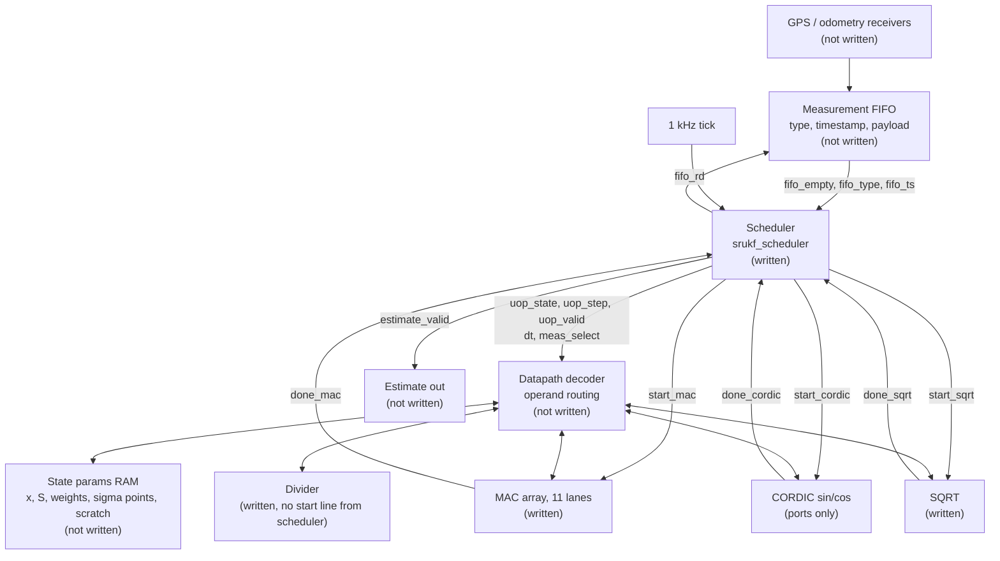
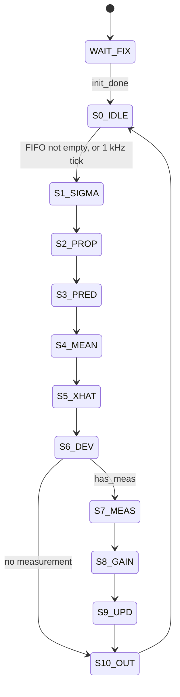
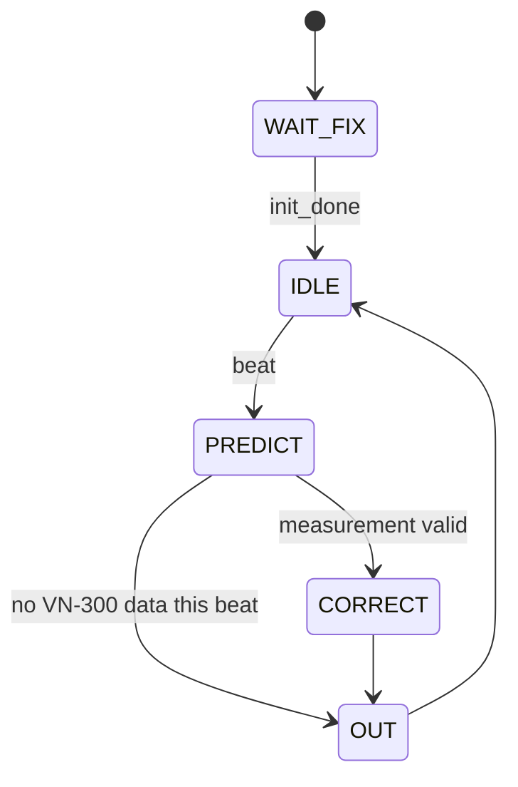

# SR-UKF hardware architecture: as proposed, as built

This describes the Kalman filter hardware as it exists across the branches of
this repo on 2026-11-21, with diagrams and step traces. It is a reading of the
code and the design notes on those branches. The Google design doc that the
scheduler's comments cite (state diagram, "pages 6-7") was not consulted.

**Is it a fixed-function UKF?** Yes. The sequence of operations is hard-wired
in the scheduler. There is no program memory and no instruction fetch. The only
things meant to be loaded at run time are numbers: the initial state and
covariance factor, the sigma-point weights and scale, and the noise terms.

Sources:

| Branch | What it holds |
|---|---|
| `Aatish-Kandaswamy` | `ukf_fpga/srukf_scheduler.v`, the scheduler (also copied to `ukf_fpga.sv` on `Sigma` and `cholDownDate`) |
| `Sigma` | `MAC.sv`, `MAC_accumulator.sv`, `MAC_array.sv`, `SQRT.sv`, `division.sv`, `sigma_generator.sv` and their design notes and tests |
| `cholDownDate` | the above plus `cholDownDate.sv` |
| `William-Kletzka` | `kalman_filter/cordic_sin_cos.v` (ports and pseudocode only), `kalman_filter/ukf_controller.v` (a second scheduler) |
| `Adam-Marrakchi` | `kalman_package_v3/`, the floating-point C reference model |

---

## 1. The filter

| | |
|---|---|
| Type | Square-root unscented Kalman filter (carries a triangular factor S of the covariance, not the covariance) |
| State (5) | x, y, forward speed v, heading θ, turn rate ω |
| Sigma points | 11 (the mean, plus and minus each of 5 directions) |
| GPS measurement | (x, y) |
| Odometry measurement | (v, θ, ω) |
| Number format | signed 32-bit fixed point, 16 fractional bits |
| Timestamps | 32-bit, microseconds |

---

## 2. Block diagram



Two sub-blocks sit behind single micro-ops and run their own state machines:

- `sigma_generator` performs all of `S1_SIGMA` using the MAC array.
- `cholDownDate` performs the covariance downdate in `S9_UPD`. As written it
  contains its own private multiplier, divider and square root, and does not
  use the shared units.

---

## 3. Scheduler state machine



What happens on leaving `S0_IDLE`:

| Condition | fifo_rd | has_meas | dt | filter_ts |
|---|---|---|---|---|
| FIFO has an entry, timestamp ≥ filter time | pulse | 1 | fifo_ts − filter_ts | := fifo_ts |
| FIFO has an entry, timestamp < filter time | pulse | 1 | 0, and sticky `ts_reject` set | unchanged |
| FIFO empty, tick fired | none | 0 | `TICK_DT` (1000 µs) | += 1000 |

So the filter is measurement-driven. It handles one measurement per pass, as
soon as one is waiting. The tick only fills gaps with a predict-only pass, and
a tick that arrives while a pass is running is ignored.

---

## 4. Micro-op table

This is the complete table in the scheduler (`uop_unit`, `uop_count`). The
"operation" column is the scheduler's own comment for that step. The table
selects which unit fires. It does not say which operands the unit reads or
where the result goes; that is the job of the missing decoder.

| State | Step | Unit | Operation |
|---|---|---|---|
| S1_SIGMA | 0 | MAC | sigma points: x ± γ·S |
| S2_PROP | 0 | CORDIC | cos θ, sin θ |
| S2_PROP | 1 | MAC | v·dt |
| S2_PROP | 2 | none (move) | store |
| S3_PRED | 0 | MAC | x' = x + cos·v·dt |
| S3_PRED | 1 | MAC | y' = y + sin·v·dt |
| S3_PRED | 2 | MAC | θ' = θ + ω·dt |
| S4_MEAN | 0 | MAC | sum x', y', θ' over sigma points |
| S4_MEAN | 1 | none (move) | store |
| S4_MEAN | 2 | MAC | W0 term |
| S5_XHAT | 0 | MAC | predicted mean x̂ |
| S6_DEV | 0 | MAC | deviations d_i = X_i − x̂ |
| S7_MEAS | 0 | MAC | h(X): predicted measurement per sigma point |
| S7_MEAS | 1 | MAC | measurement mean ẑ |
| S7_MEAS | 2 | MAC | cross-covariance P_xz |
| S7_MEAS | 3 | SQRT | measurement factor S_z |
| S8_GAIN | 0 | MAC | forward solve |
| S8_GAIN | 1 | MAC | back solve |
| S9_UPD | 0 | MAC | innovation z − ẑ |
| S9_UPD | 1 | MAC | x += K·r |
| S9_UPD | 2 | SQRT | S downdate |

S7 to S9 are marked in the source as placeholders "with a plausible unit
sequence; the doc has not detailed them yet".

Each micro-op is coarser than one arithmetic operation. `S1_SIGMA` step 0 is
15 multiplies. `S9_UPD` step 2 is a full 5×5 Cholesky downdate. Sections 6 and
7 trace what happens inside those two.

---

## 5. Step traces of the scheduler

These come from simulating `srukf_scheduler` unmodified in VCS with stub units
in place of the real ones. The stubs answer `done` after a fixed delay: MAC 2
clocks, CORDIC 16, SQRT 24. Those delays are placeholders, so **the order of
events is real and the clock numbers are not**. Clock 0 is the cycle the pass
leaves `S0_IDLE`.

### Pass A: tick with the FIFO empty (predict only)

| Clock | State | Event |
|---|---|---|
| 0 | S1_SIGMA | `dt_wr`, dt = 1000 µs, has_meas = 0. Start MAC {S1,0} |
| 4 | S2_PROP | Start CORDIC {S2,0} |
| 22 | S2_PROP | Start MAC {S2,1}. Step 2 is a move and takes one clock |
| 27 | S3_PRED | Start MAC {S3,0} |
| 31 | S3_PRED | Start MAC {S3,1} |
| 35 | S3_PRED | Start MAC {S3,2} |
| 39 | S4_MEAN | Start MAC {S4,0}. Step 1 is a move |
| 44 | S4_MEAN | Start MAC {S4,2} |
| 48 | S5_XHAT | Start MAC {S5,0} |
| 52 | S6_DEV | Start MAC {S6,0} |
| 56 | S10_OUT | `estimate_valid`. filter_ts = 1000 |
| 57 | S0_IDLE | |

### Pass B: GPS measurement, timestamp 4500 µs (predict then correct)

Filter time was 1000 µs after pass A.

| Clock | State | Event |
|---|---|---|
| 0 | S1_SIGMA | `fifo_rd` (GPS). `dt_wr`, dt = 3500 µs, has_meas = 1. Start MAC {S1,0} |
| 4 to 52 | S2 to S6 | Identical to pass A |
| 56 | S7_MEAS | Start MAC {S7,0} |
| 60 | S7_MEAS | Start MAC {S7,1} |
| 64 | S7_MEAS | Start MAC {S7,2} |
| 68 | S7_MEAS | Start SQRT {S7,3} |
| 94 | S8_GAIN | Start MAC {S8,0} |
| 98 | S8_GAIN | Start MAC {S8,1} |
| 102 | S9_UPD | Start MAC {S9,0} |
| 106 | S9_UPD | Start MAC {S9,1} |
| 110 | S9_UPD | Start SQRT {S9,2} |
| 136 | S10_OUT | `estimate_valid`. filter_ts = 4500 |
| 137 | S0_IDLE | |

### Pass C: odometry measurement, timestamp 3000 µs (older than filter time)

Filter time was 4500 µs after pass B.

| Clock | State | Event |
|---|---|---|
| 0 | S1_SIGMA | `fifo_rd` (ODOM). `dt_wr`, dt = 0, has_meas = 1. `ts_reject` set. Start MAC {S1,0} |
| 4 to 136 | S2 to S10 | Same sequence as pass B, with meas_select = 1 |
| 136 | S10_OUT | `estimate_valid`. filter_ts stays 4500, `ts_reject` = 1 |

Note that the full prediction sequence still runs with dt = 0. Nothing skips
it.

---

## 6. Inside `S1_SIGMA`: the sigma generator

From `sigma_generator.sv` and `SIGMA_GENERATOR_DESIGN.md`. The generator takes
an upper-triangular S, so only 15 of its 25 entries are non-zero, and it
computes γ·S for those 15 using the 11-lane MAC array in two batches.

| Phase | What happens |
|---|---|
| IDLE | Wait for `start`. Capture state, S and γ into private registers |
| GENERATE_CENTER | sigma[0] = state |
| WAIT_GRANT | Raise `mac_request`, wait for `mac_grant` and an idle array |
| CALCULATE_OFFSETS (batch 1) | Launch 11 products on lanes 0 to 10: γ × S00, S01, S02, S03, S04, S11, S12, S13, S14, S22, S23 |
| WAIT_MAC_DONE | Wait for all 11 `result_valid` pulses (the notes say 2 clocks; a watchdog times out after 16) |
| CALCULATE_OFFSETS (batch 2) | Launch 4 products on lanes 0 to 3: γ × S24, S33, S34, S44 |
| WAIT_MAC_DONE | Wait for 4 `result_valid` pulses |
| GENERATE_POS_NEG | sigma[i+1] = state + offset row i, sigma[i+6] = state − offset row i, with saturation |
| STORE_SIGMA_POINTS | Publish all 55 values at once, pulse `done` |

Result layout:

```
sigma[0]      = x
sigma[1..5]   = x + γ · (row 0..4 of S)
sigma[6..10]  = x − γ · (row 0..4 of S)
```

---

## 7. Inside `S9_UPD` step 2: the Cholesky downdate

From `cholDownDate.sv`. It computes S_new such that
S_new·S_newᵀ = S·Sᵀ − u·uᵀ, for a lower-triangular 5×5 S and a 5-vector u.

For each column k = 0..4:

| State | Operation | Unit |
|---|---|---|
| ST_DIAG_MAC | S_kk², u_k² | multiplier |
| ST_DIAG_SUB | diff = S_kk² − u_k² | subtractor |
| ST_DIAG_SQRT | S_kk_new = √diff | SQRT |
| ST_CALC_C | c = S_kk_new / S_kk_old | divider |
| ST_CALC_H | h = u_k / S_kk_old | divider |

Then for each row j = k+1..4 of that column:

| State | Operation | Unit |
|---|---|---|
| ST_ROW_MAC_HU | h · u_j | multiplier |
| ST_ROW_SUB | num = S_jk − h·u_j | subtractor |
| ST_ROW_DIV_S | S_jk_new = num / c | divider |
| ST_ROW_MAC_U | u_j_new = c·u_j − h·S_jk_new | multiplier |

Operation count for one downdate, from the loop bounds:

| Operation | Count | Clocks each (from module headers) |
|---|---|---|
| Square root | 5 | 24 |
| Division | 20 (10 per-column, 10 per-row) | 48 |
| Multiply | about 40 | 1 |

That is on the order of 1,100 clocks per downdate, dominated by the divisions.
This figure is derived from the headers, not simulated. A GPS correction needs
two downdates and an odometry correction three, one per measurement component.

Error exits: `error_indefinite` if S_kk² − u_k² ≤ 0, `sqrt_by_neg`, and
`error_divide`.

---

## 8. What is not built

| Missing piece | Needed by |
|---|---|
| CORDIC sin/cos body | S2 |
| Datapath decoder and state/covariance storage | every state |
| Rebuild of S after prediction (QR, or equivalent) | between S6 and S7; no state for it exists |
| Process noise | prediction; no state for it exists |
| Measurement covariance factor S_z, real sequence | S7 |
| Triangular solves for the gain | S8 |
| Heading wrap-around in means and residuals | S4, S5, S6, S9 |
| Innovation gating (the C model rejects outliers) | S9 |
| Measurement receivers and FIFO | input |
| MAC array arbiter | sharing the array between clients |
| Output and configuration interface | output |

## 9. Where the pieces disagree

| Topic | One place says | Another says |
|---|---|---|
| State order | C model: x, y, v, θ, ω | Sigma generator notes: x, y, θ, ω, v |
| Triangle | Sigma generator: upper, P = SᵀS, uses rows | C model and `cholDownDate`: lower, P = S·Sᵀ |
| Motion model | C model: constant-turn-rate arc with a straight-line limit | Scheduler S3: straight-line step |
| Unit sharing | Sigma generator: shared MAC array via request/grant | `cholDownDate`: private multiplier, divider, square root |
| Scheduler | `srukf_scheduler` | `ukf_controller.v` (different interface) |
| Reference | C model is double-precision floating point | Hardware is Q16.16 fixed point |

---

## 10. Revised direction (2026-11-21)

Sections 1 to 9 describe the design as it exists on the branches. This section
records decisions made since, and what they change. The chip-level picture is
in [`fusion_chip_architecture.md`](fusion_chip_architecture.md) and the input
side in [`timestamper_architecture.md`](timestamper_architecture.md).

### 10.1 Decisions

| Decision | Effect on the filter |
|---|---|
| Position, heading and turn rate come from the VN-300, using its fused output | The "GPS" and most of the "odometry" measurement have the same source |
| Forward speed comes from one dead-wheel encoder | The only wheel input is a single scalar |
| All inputs are sampled on one fixed beat (default 100 Hz) | Every pass is predict-by-one-period, then correct with one combined measurement |
| Target is a Tiny Tapeout slot | One time-shared multiplier, small memory, no parallel lanes |

### 10.2 What changes in the scheduler



| Removed | Why |
|---|---|
| Measurement FIFO, `fifo_type`, `meas_select` | One combined measurement per beat |
| `fifo_ts` subtraction and the stale-timestamp case | dt is the beat period, a constant |
| The 1 kHz predict-only tick | The beat is the only trigger |

The existing {state, step} micro-op indexing carries over.

### 10.3 Serial datapath

| | Parallel (on the branches) | Serial (proposed) |
|---|---|---|
| Multipliers | 11-lane array, plus private ones in `cholDownDate` | one, time-shared; divider and square root share its adder |
| Storage | registers inside each block | one small addressed memory, about 40 words |
| Sigma points | all 55 values stored | generated one at a time and regenerated for the deviation pass |
| Micro-op | "run this sub-block" | one multiply-accumulate with operand and destination addresses |
| Size | about 134,000 NAND2 equivalents (synthesized) | 15,000 to 18,000 (estimate) |
| Tiny Tapeout | does not fit | about 7 tiles |

Time check: about 2,000 multiplies per pass at 32 clocks each, plus the
divisions, is under 100,000 clocks. At 10 MHz that allows 100 Hz with little
slack, or 50 Hz comfortably.

### 10.4 Scalar measurement updates

All five measured values are state variables read directly. Each can be
applied on its own:

```
for each measured component i:
    innovation = z_i − x_i
    s          = (row i of S) · (row i of S) + r_i        dot product
    K          = S · (row i of S)ᵀ / s                     one divide
    x          = x + K · innovation
    S          = downdate(S, K · sqrt(s))                  existing cholDownDate
```

This replaces S7 and S8: no measurement sigma points, no S_z factorisation, no
triangular solves. It assumes the noise on each component is independent of
the others. Heading innovation must be wrapped to ±180°.

### 10.5 Using the VN-300's fused output

The VN-300 runs its own filter, so its position errors are correlated from one
reading to the next. A Kalman filter assumes they are not, and will trust the
position more than it should. Two measures:

- Take the position noise `r` from the VN-300's reported uncertainty, not a
  fixed number.
- Check on a recorded drive: run the C model with raw GNSS position and with
  fused position, and compare return-to-start error, behaviour through a
  GNSS-poor stretch, and the innovation consistency score the C model already
  computes for its outlier gate.

### 10.6 Still to settle

1. State order, triangle convention and motion model (section 9).
2. Fixed-point C model in hardware operation order, to test blocks bit for bit
   and to find out whether 16 fractional bits are enough.
3. Rebuilding S after prediction without QR: accumulate the covariance and
   take a 5×5 Cholesky factor, or apply repeated rank-1 updates with a variant
   of `cholDownDate`.
4. Whether `cholDownDate` is rewritten to use the shared multiplier, divider
   and square root.
