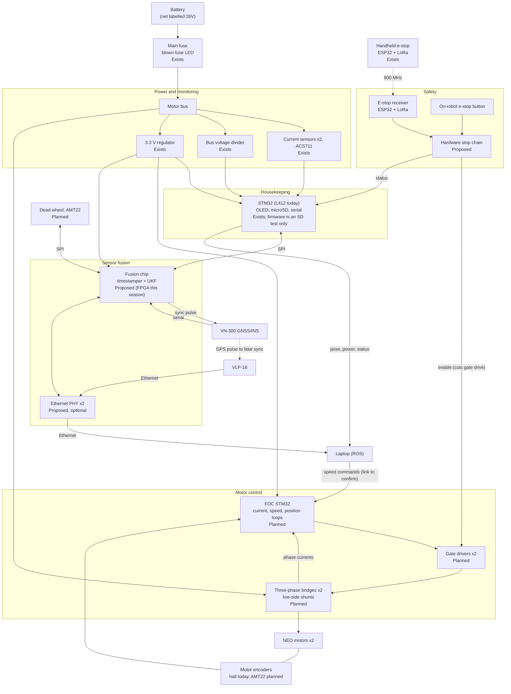
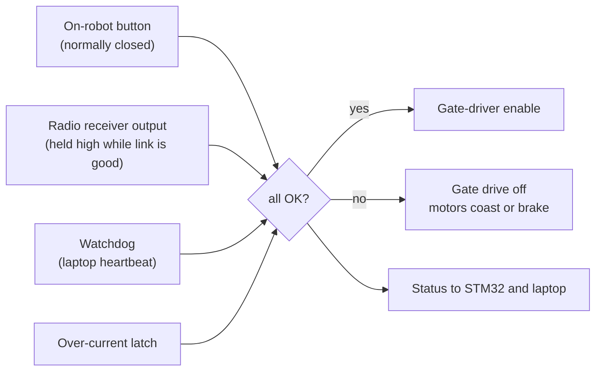

# Unified board: architecture for discussion

Written 2026-11-21 for the team meeting. It puts power distribution, motor
control, e-stop and sensor fusion on one picture.

Each item is marked by where it comes from:

| Mark | Meaning |
|---|---|
| **Exists** | In `umigv/embedded_hardware` today |
| **Planned** | In the team's Motor Board or Technical Planning documents |
| **Proposed** | From the sensor-fusion discussions; not agreed yet |

What was read to produce this: the Altium schematics of the power board (as
extracted text, not a full review), its firmware, the e-stop board's README,
the Motor Board and 2026-2027 Technical Planning documents, and the VN-300
interface document. The power board's linked Google doc was not read.

Related: [`fusion_chip_architecture.md`](fusion_chip_architecture.md),
[`timestamper_architecture.md`](timestamper_architecture.md),
[`ukf_architecture.md`](ukf_architecture.md).

---

## 1. Whole-board diagram



---

## 2. The four functions

### 2.1 Power and monitoring (exists)

| Item | Detail |
|---|---|
| Input | Battery through a blade fuse, with a blown-fuse indicator |
| Outputs | Two motor-controller feeds |
| Sensing | ACS711 hall current sensor (±15 A part) per feed; scaled bus voltage |
| Logic supply | Buck regulator to 3.3 V |
| Microcontroller | STM32L412, 32-pin, with OLED and microSD |
| Firmware | An SD card test and an empty main loop. The ADC is not configured |

Schematic notes question whether the current sensing suits the expected motor
current; one note mentions 80 A against a ±15 A sensor.

### 2.2 Motor control (planned)

From the Motor Board document:

- An ODrive-style brushless drive: three-phase MOSFET bridge, low-side shunts,
  field-oriented control and PID, with torque, velocity and position modes.
- A dedicated FOC microcontroller, "probably another STM32", still to be
  researched.
- The API to the rest of the robot must not change.
- The AMT22 encoder does not mount on the NEO motor without a custom adapter
  and sleeve.

### 2.3 E-stop (exists as a handheld transmitter)

The repo holds the handheld transmitter: ESP32, 900 MHz LoRa radio, a switch.
Its README gives the receiving path as:

```
ESP32 → serial → script on the laptop → file → ROS 2 /estop topic
```

So as documented, a stop command passes through the laptop and ROS before it
reaches the motors. The receiver hardware on the robot was not found in the
repo.

### 2.4 Sensor fusion (proposed)

A chip that samples the dead wheel and VN-300 on a fixed beat, runs the UKF,
and publishes pose. Optionally it sits in the lidar's Ethernet path and
corrects azimuth for heading. This season the same logic would run on a small
FPGA; a Tiny Tapeout chip would follow once it is proven.

---

## 3. Who talks to whom

| From | To | Link | Carries | Status |
|---|---|---|---|---|
| Current and voltage sensing | Housekeeping STM32 | analog | motor feed current, bus voltage | Exists (unused in firmware) |
| Housekeeping STM32 | Fusion chip | SPI | settings, pose, status; VN-300 values in fallback mode | Proposed |
| Fusion chip | Dead wheel | SPI | position read each beat | Proposed |
| Fusion chip | VN-300 | one wire | sync pulse each beat | Proposed |
| VN-300 | Fusion chip (or STM32) | serial | position, heading, turn rate | Proposed |
| VN-300 | Lidar | one wire | GPS pulse-per-second, for the lidar's clock | Proposed |
| Lidar | Laptop, through the chip | Ethernet | point data, heading-corrected | Proposed, optional |
| Housekeeping STM32 | Laptop | USB or serial | pose, power, fault status | Proposed |
| Laptop | FOC STM32 | to confirm | speed commands | Existing API |
| Motor encoders | FOC STM32 | hall or SPI | rotor position | Exists / planned |
| Stop chain | Gate drivers | one wire | enable | Proposed |

**Motor control and sensor fusion share no signals.** The motor loop uses the
motor encoders. The filter uses the dead wheel and VN-300. They meet only
through the laptop, which reads the pose and sends speed commands.

---

## 4. Stop chain



Proposed properties:

- **Hardware only.** No microcontroller firmware and no laptop software sits
  between a stop request and the gate drivers.
- **Fail-safe.** Every input must be actively held in its "OK" state. A broken
  wire, a dead radio link or a crashed laptop reads as "stop".
- **Latched.** After a stop, a deliberate reset is required.
- **Reported, not routed.** The laptop and ROS are told what happened; they
  are not part of the path.

The fusion chip is deliberately not in this chain. A timestamp for each stop
event can be taken with the chip's spare capture input.

---

## 5. Microcontrollers

| Device | Job | Why separate |
|---|---|---|
| FOC STM32 | Motor current, speed and position loops | Hard real-time; a fault elsewhere must not disturb it |
| Housekeeping STM32 | Power monitoring, display, logging, VN-300 parsing (fallback), link to the laptop | Changes often; owned by a different group |
| E-stop ESP32 | Radio receiver | Already exists; safety function |
| Fusion chip or FPGA | Timestamping and UKF | The team's own IP |

The 32-pin L412 on the current board is probably too small for the
housekeeping role once the chip link, VN-300 serial and laptop link are added.

---

## 6. Layout zones

The Technical Planning document lists interference with the GPS as an open
problem. Bringing motor switching onto the same board as the fusion
electronics makes placement matter.

```
┌───────────────────────────┬──────────────────────────────┐
│  HIGH CURRENT             │  LOGIC                       │
│  fuse, bus capacitors     │  housekeeping STM32          │
│  bridges, gate drivers    │  fusion chip, oscillator     │
│  shunts                   │  Ethernet PHYs               │
│  motor connectors         │  sensor connectors           │
├───────────────────────────┤  (VN-300, dead wheel, lidar) │
│  FOC STM32                │                              │
│  current-sense amplifiers │  e-stop receiver             │
└───────────────────────────┴──────────────────────────────┘
        motor side                     sensor side
```

- Keep switching currents and their return paths on the motor side.
- Sensor cables leave from the far edge.
- The fusion chip's oscillator and the Ethernet pairs stay away from the
  bridges.

---

## 7. This season and next

| | This season (hardware frozen 12/6) | Later |
|---|---|---|
| Fusion logic | Small FPGA on a daughter board | Tiny Tapeout chip on the same footprint or an adapter |
| VN-300 parsing | STM32 | On-chip parser, STM32 kept as fallback |
| Lidar correction | Laptop, from the published pose | In-line on the chip, if area allows |
| Motor control | As the Motor Board document plans | Unchanged |
| E-stop | Hardware stop chain | Unchanged |

The Motor Board document already allows daughter boards ("can be split into
different boards for now"), so the fusion logic does not have to block the
main board.

---

## 8. Questions for the meeting

**Safety**

1. Is there a hardware path from the e-stop receiver to the motors today, or
   does it only go through the laptop?
2. What does a stop do to the motors: coast, brake, or cut the bus?

**Motor control**

3. Which microcontroller for FOC, and one per motor or one for both?
4. What is the peak motor current, and are the ±15 A sensors and the fuse
   sized for it?
5. Which motor encoder, given the AMT22 mounting problem?
6. How do speed commands reach the motor controller today?

**Sensor fusion**

7. Does the UKF take the VN-300's fused position or its raw GNSS position?
8. Where is the dead wheel mounted, and which AMT22 variant is it?
9. Beat rate: 50 or 100 Hz?
10. FPGA daughter board this season: which part, and who lays it out?

**Board**

11. One board or a stack? Does motor switching share a PCB with the VN-300's
    signals at all?
12. Which microcontroller replaces the L412 for housekeeping?
13. Is a tapeout a goal for this year's team, and if so which shuttle?
